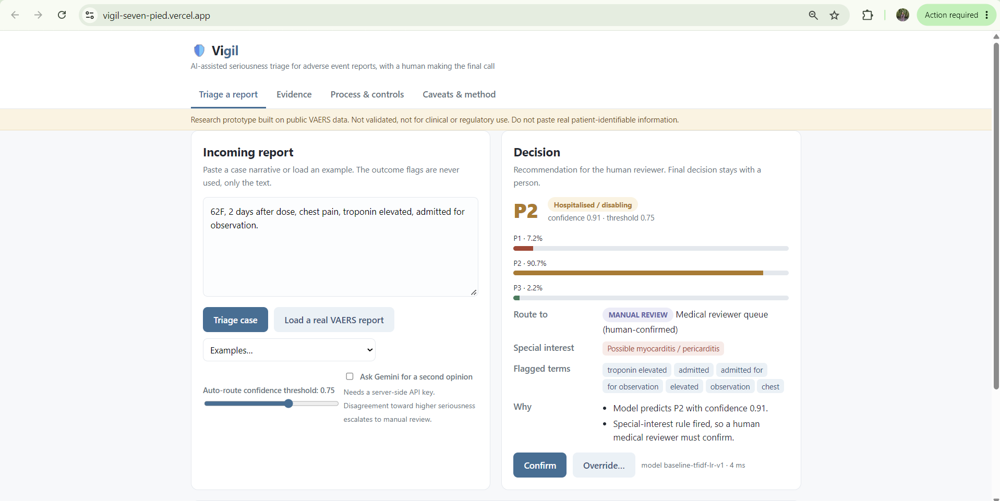
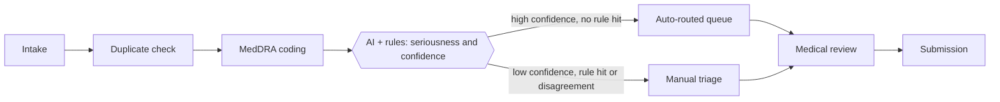

# 🛡️ Vigil

**AI-assisted seriousness triage for adverse event reports (ICSRs), with a human making the final call.**

Pharmacovigilance teams must read every adverse event report, decide how serious it is, and route it. Serious, unexpected cases carry regulatory clocks (typically 15 calendar days), so a missed one is costly. Vigil reads a report narrative, predicts priority, explains why, and routes it to a queue. Low-confidence cases and special-interest events always go to a person.

> **Prototype, not a validated system.** Built on public VAERS data. See [Honest caveats](#honest-caveats).



## What it does

| Layer | What happens |
|---|---|
| **Model** | TF-IDF (1-2 grams) + class-weighted logistic regression, trained on the narrative text only |
| **Rules** | Regex triggers for adverse events of special interest (anaphylaxis, myocarditis, Guillain-Barré, TTS, serious neuro) plus death/arrest, with a simple negation check. Rules can only *raise* priority |
| **Routing** | Confidence ≥ threshold → auto-routed queue. Below threshold, rule hit, or second opinion more serious → manual review |
| **Second opinion** | Optional Gemini few-shot call. Advisory only |
| **Audit** | Every decision logged: input hash, model version, threshold, probabilities, rules, routing, reviewer action |
| **UI** | Triage · Evidence (metrics, threshold trade-off, subgroups, errors) · Process & controls (as-is/to-be, effort estimate, controls, risks) · Caveats |

Priority definitions (from the reporter's own VAERS flags): **P1** died or life-threatening · **P2** hospitalised or disabled · **P3** everything else.

## Results (held-out test set, 5,932 reports)

| | Precision | Recall |
|---|---|---|
| P1 | 65% | 65% |
| P2 | 44% | 74% |
| P3 | 98% | 95% |
| **Serious (P1+P2) vs P3** | 58% | **83%** (85% with rules) |

At the default threshold **0.75**: about 81% of cases are auto-routed, 19% go to manual review, and 4.4% of serious cases are auto-routed as non-serious. Subgroup recall, confusion matrix and error analysis are in the app's **Evidence** tab (generated from `public/metrics.json`).

The model deliberately over-flags (precision is modest) because missing a serious case is worse than reviewing a mild one. Inference takes well under 1 ms per case. The Gemini comparison is not pre-filled: run `ml/eval_gemini.py` (see below).

## Project layout

```
public/index.html      single-page UI (no build step)
public/metrics.json    evaluation output, read by the UI
public/samples.json    real short VAERS test reports for the demo button
api/triage.js          POST /api/triage   model + rules + routing
api/gemini.js          POST /api/gemini   optional second opinion (key stays server-side)
api/_lib/triage.js     pure-JS inference of the exported model
api/_lib/model.json    exported TF-IDF vocabulary + coefficients (1.7 MB)
ml/train.py            data prep, labels, training, evaluation, export
ml/rules.json          special-interest rules
ml/eval_gemini.py      measures Gemini vs baseline on a sample
dev.js                 zero-dependency local server
vercel.json            Vercel function config
```

The model is trained in Python, exported to JSON, and scored in JavaScript, so Vercel needs no Python or scikit-learn at runtime. The JS output was checked against scikit-learn on 42 sample reports: identical predictions, probabilities within 0.004.

## Run locally

Requires Node 18+. No `npm install` needed.

```bash
git clone <your-repo-url> && cd vigil
cp .env.example .env.local        # optional: add your Gemini key
node dev.js                        # or: npm run dev
# open http://localhost:3000
```

## Deploy (GitHub + Vercel)

1. Create a GitHub repo and push this folder:
   `git init && git add . && git commit -m "Vigil" && git branch -M main && git remote add origin <url> && git push -u origin main`
2. In Vercel: **Add New → Project → Import** the repo. Framework preset **Other**; leave build and output settings empty (Vercel serves `public/` and `api/` automatically).
3. Optional: **Settings → Environment Variables**, add `GEMINI_API_KEY` (and optionally `GEMINI_MODEL`). Redeploy.
4. Open the deployment URL.

## Gemini

An **API key** from [Google AI Studio](https://aistudio.google.com/apikey) works here. A Gemini *app* subscription (Google AI Pro) is a separate product from API access, so create the key in AI Studio. The key is read from `GEMINI_API_KEY` on the server only and never reaches the browser. `api/gemini.js` has a basic rate limit and a length cap. The model defaults to `gemini-2.5-flash`; set `GEMINI_MODEL` to use another.

Measure it against the baseline (this fills the Evidence tab):

```bash
GEMINI_API_KEY=... python ml/eval_gemini.py --data path/to/2025VAERSDATA.csv --n 150
```

Do not send real patient-identifiable data through a consumer API key. In production, use a contracted enterprise endpoint with identifiers removed.

## Retrain

```bash
pip install -r ml/requirements.txt
python ml/train.py --data path/to/2025VAERSDATA.csv --symptoms path/to/2025VAERSSYMPTOMS.csv --out .
```

Data: <https://vaers.hhs.gov/data/datasets.html>. This rewrites the model, metrics and samples. Pipeline: join DATA and SYMPTOMS on `VAERS_ID` (repeated IDs merged: flags OR-ed, longest narrative kept) → label P1/P2/P3 → **drop flags and structured fields from model input** → stratified 70/15/15 split → choose C on validation serious-recall → evaluate on test → export.

## Process, controls and effort (consulting layer)

Full detail is in the app's **Process & controls** tab: as-is vs to-be map (only seriousness assessment changes), an assumption-based effort estimate (cases × auto-routed share × minutes saved, shown next to the measured miss rate), control design (human-in-the-loop, GxP-style validation, audit trail, drift monitoring), and risks and change management (reviewer trust, automation bias, regulator expectations, accountability).



## Honest caveats

- VAERS is spontaneous, unverified and noisy, with duplicates.
- Labels are the reporter's own flags, not clinical adjudication. P2 labels are especially inconsistent.
- Narratives often state the outcome in plain words, so part of the performance is keyword reading, not clinical reasoning.
- One year of data, random split, no temporal or external validation.
- Rule negation is crude (for example "father died" can trigger the death rule), which is why rule hits go to a human.
- The effort estimate rests on stated assumptions, not measured reviewer times.
- The audit log in the demo lives in the browser; production needs an immutable store.
- This is a prototype, not a validated system.
